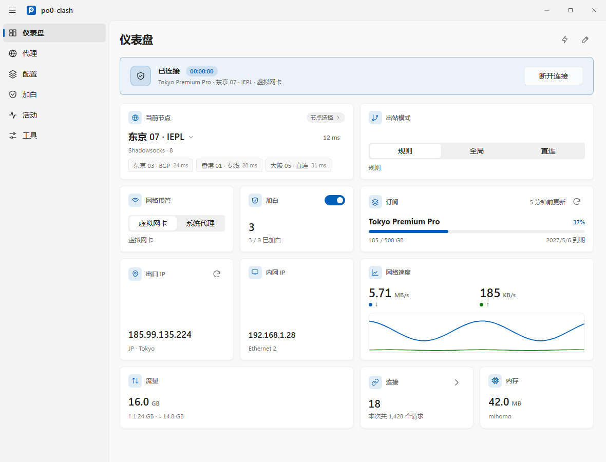
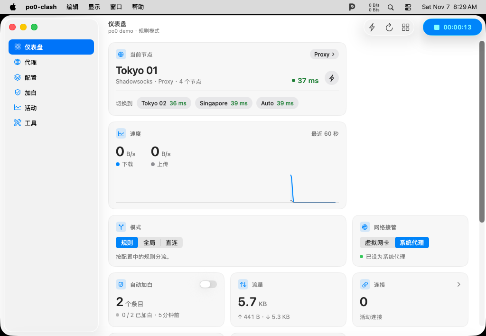
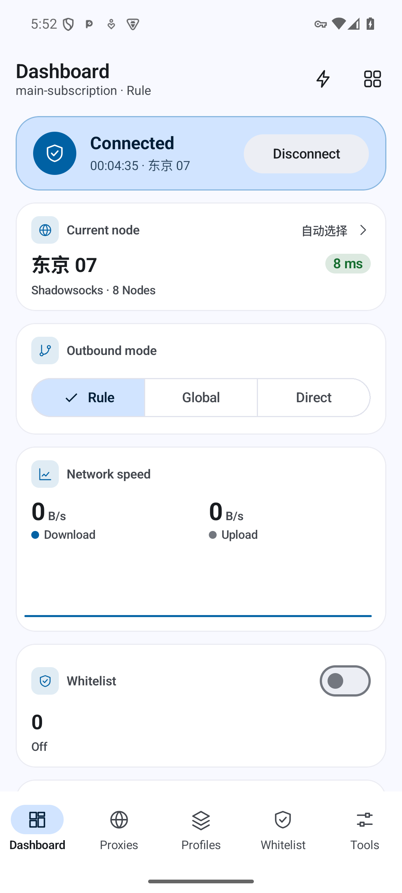
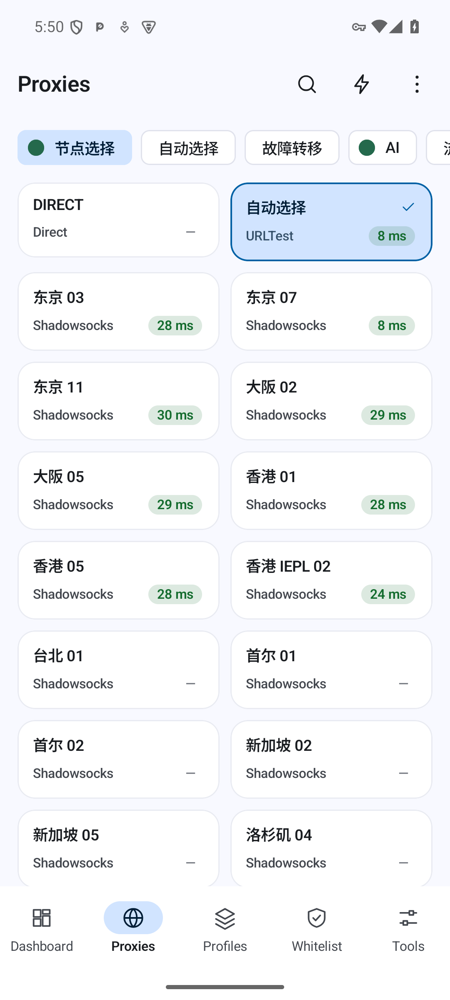
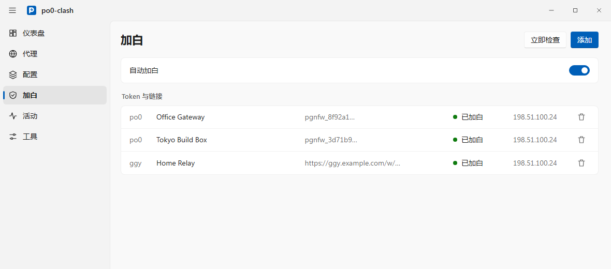

# po0-clash

[**English**](README_en.md)

基于共享 Rust 核心（`crates/core`）与原版 [`mihomo`](https://github.com/MetaCubeX/mihomo) 构建的 macOS、Windows、Android 三端原生代理客户端，内置 `po0` 与 `ggy` 防火墙自动加白（源自 [`po0fw`](https://github.com/w0ven/po0fw)）。

桌面端的界面照 Clash Verge Rev，Android 的界面照 FlClash。下面的截图是改版前的界面。

- **macOS（`apps/macos`）**：Swift 外壳加 `WKWebView`，界面与 Windows 共用；另有状态栏快捷面板和全局快捷键。
- **Windows（`apps/windows`）**：Tauri 2，界面用 React 与 MUI；系统托盘与全局快捷键。
- **Android（`apps/android`）**：Kotlin + Jetpack Compose，Material 3 卡片网格、进程内 `libmihomo`、快捷设置磁贴与 Android TV Leanback 入口。

`po0-clash` 是独立应用（`io.github.yuuukicreation.po0clash`），拥有独立的安装标识、进程与服务名、数据目录和 `po0clash://` URL Scheme，可与官方 [FlClash](https://github.com/chen08209/FlClash) 同时安装、同时运行。

## 界面预览

### Windows（React / MUI）

<p align="center">
  <picture>
    <source media="(prefers-color-scheme: dark)" srcset="docs/features/images/windows_dashboard_dark_zh.png">
    
  </picture>
</p>

### macOS（WKWebView，共用桌面前端）

<p align="center">
  <picture>
    <source media="(prefers-color-scheme: dark)" srcset="docs/features/images/macos_dashboard_dark_en.png">
    
  </picture>
</p>

### Android（Jetpack Compose Material 3 Expressive）

<p align="center">
  
  &nbsp;&nbsp;
  
</p>

## 功能特性

- **`po0` 与 `ggy` 自动加白**：在统一的「加白」页面管理 `po0` token（`pgnfw_`）与 `ggy` 链接。应用运行期间，`po0` 条目每 5 秒只读检查一次白名单，仅在本机 `/24` 网段缺失时写入；`ggy` 链接每 11 秒自动刷新。加白请求通过三层机制强制直连（`po0-direct` 本地监听、`DIRECT` 规则 + `route-exclude-address`、Android VPN 路由分流），无论代理是否开启，始终加白真实物理出口 IP。
- **配置与覆写**：支持导入 Clash 订阅（展示流量与到期时间并支持定时自动更新）、本地 YAML 文件以及单节点分享链接（`ss://`、`vless://`、`vmess://`、`trojan://`、`hysteria2://` 等，支持单节点改名与删除）。支持原配置编辑、合并后配置预览，以及标准规则覆写、JavaScript 脚本（`main(config)`）、自定义策略组与规则 YAML 三种覆写方式。
- **概览、代理与实时活动**：可自由显隐和排序的 Bento 概览卡片（实时流量图、当前速率、出站模式、网络检测、内存占用、快捷开关、订阅摘要），支持标签页或列表布局、节点搜索、排序与并发延迟测速的代理页，以及集成最近请求、活动连接与多条件过滤日志的「活动」页。
- **系统集成与备份同步**：桌面端支持 TUN 与系统代理，Android 支持 `VpnService`、分应用代理与指定 Wi-Fi 自动断开；内置 Geo 数据库（`GeoIP.dat`、`GeoSite.dat`、`country.mmdb`、`ASN.mmdb`）与外部提供者管理；支持 WebDAV 与本地 `.zip` 备份恢复、启动崩溃循环保护，以及简体中文、English、日本語、Русский 四种界面语言。

## 安装

从 [Releases](https://github.com/yuuuki-creation/po0-clash/releases) 下载对应平台的安装包，或在 Windows / macOS 上执行下方一键安装命令。完整说明见 [docs/install.md](docs/install.md)。

### Windows（Windows 10 / 11 x64）

在 PowerShell 中执行以下命令，自动下载最新安装包、校验 SHA-256 并静默安装：

```powershell
irm https://github.com/yuuuki-creation/po0-clash/releases/latest/download/install-windows-native.ps1 | iex
```

也可以从 [Releases](https://github.com/yuuuki-creation/po0-clash/releases) 下载 `po0-clash-<版本>-windows-x64-setup.exe` 双击安装。

- 安装包未包含 Authenticode 代码签名。若弹出 Windows SmartScreen 提示，点击「更多信息」->「仍要运行」；若被 Windows 11「智能应用控制（Smart App Control）」拦截，请前往「Windows 安全中心」->「应用和浏览器控制」->「智能应用控制设置」将其关闭。
- Windows 版默认以管理员权限运行，以便 TUN 模式创建虚拟网卡。

### macOS（macOS 13+，Apple Silicon 与 Intel 通用）

在「终端（Terminal）」执行以下命令，自动下载最新版本、校验 SHA-256、安装到 `/Applications/po0-clash.app`、清除隔离属性并启动：

```bash
curl -fsSL https://github.com/yuuuki-creation/po0-clash/releases/latest/download/install-macos-native.sh | bash
```

在 `bash -s --` 后传入版本号或本地 `.zip` 路径可安装指定版本：

```bash
curl -fsSL https://github.com/yuuuki-creation/po0-clash/releases/latest/download/install-macos-native.sh | bash -s -- 8.1.1
```

首次开启 TUN 模式时，macOS 会弹出一次管理员密码输入框，用于为内置 `mihomo` 核心授予 `setuid-root` 权限。

### Android（Android 8.0+）

从 [Releases](https://github.com/yuuuki-creation/po0-clash/releases) 下载对应架构的 APK 安装：

| 文件名 | 适用设备 |
|---|---|
| `po0-clash-<版本>-android-arm64-v8a.apk` | 绝大多数新款手机、平板与电视盒子（推荐） |
| `po0-clash-<版本>-android-armeabi-v7a.apk` | 较老的 32 位 ARM 设备 |
| `po0-clash-<版本>-android-x86_64.apk` | 64 位 x86 模拟器与设备 |

同一时间请只在一个代理客户端中开启系统代理或 TUN/VPN，以免抢占路由。

### 从旧版本升级或迁移

- **从 `po0-clash` 5.x / 6.x（Flutter 版）升级**：直接覆盖安装 7.3+ 即可。Windows 安装器会自动卸载旧版 Inno Setup 客户端再装入新版；macOS 安装脚本会替换 `/Applications/po0-clash.app`；Android 使用相同签名可直接覆盖安装。首次启动时，7.3+ 会自动导入旧版的订阅与加白条目，也可以在「工具」->「备份」中导入旧版导出的本地 `.zip` 或 WebDAV 备份。
- **从早期 `v0.8.98-po0.N`（FlClash-po0）迁移**：早期构建使用官方 `FlClash` 的应用 ID，`po0-clash` 不会覆盖它们。请先从旧版导出备份或复制加白 token 并导入 `po0-clash`，再手动卸载旧版。

## 使用自动加白

<p align="center">
  <picture>
    <source media="(prefers-color-scheme: dark)" srcset="docs/features/images/whitelist_dark_zh.png">
    
  </picture>
</p>

1. 打开主导航中的「加白」。
2. 粘贴 `po0` token（`pgnfw_...` 或完整 URL）或 `ggy` 链接（`http(s)://...`），按需填写备注名，点击「添加」。
3. 保持右上角「自动加白」总开关开启；也可随时点击页面上或状态栏 / 托盘菜单中的「立即加白」手动触发一次检查。

## 架构与开发

| 路径 | 说明 |
|---|---|
| [`crates/core`](crates/core) | 共享 Rust 核心，负责订阅与配置管理、配置合并与覆写、`mihomo` 进程监管与 REST/WS 客户端、`po0`/`ggy` 加白引擎、WebDAV 与本地备份 |
| [`crates/ffi`](crates/ffi) | UniFFI 绑定层，向 Swift（macOS）与 Kotlin（Android）暴露 `po0-core` 接口 |
| [`apps/macos`](apps/macos) | macOS 13+ 客户端（Swift 外壳 + `WKWebView`，界面与 Windows 共用） |
| [`apps/windows`](apps/windows) | Windows 10/11 客户端（Tauri 2 + React + MUI），桌面端共用的界面也在这里 |
| [`apps/android`](apps/android) | Android 8.0+ 原生客户端（Kotlin + Jetpack Compose + JNI `libmihomo`） |

项目目标、功能设计、ADR 与构建发版流程见 [`docs/`](docs/README.md)；代码规范与开发工作流见 [`AGENTS.md`](AGENTS.md)。

## 致谢与许可

- [MetaCubeX/mihomo](https://github.com/MetaCubeX/mihomo)：Clash Meta 代理核心
- [clash-verge-rev/clash-verge-rev](https://github.com/clash-verge-rev/clash-verge-rev)（GPL-3.0）：Windows 与 macOS 的界面照它的布局、样式和组件改写
- [chen08209/FlClash](https://github.com/chen08209/FlClash)（GPL-3.0）：早期版本所基于的上游客户端，Android 的界面照它的样式重做
- [w0ven/po0fw](https://github.com/w0ven/po0fw)：`po0` 防火墙自动加白协议与逻辑

以 [GPL-3.0](LICENSE) 许可发布。
