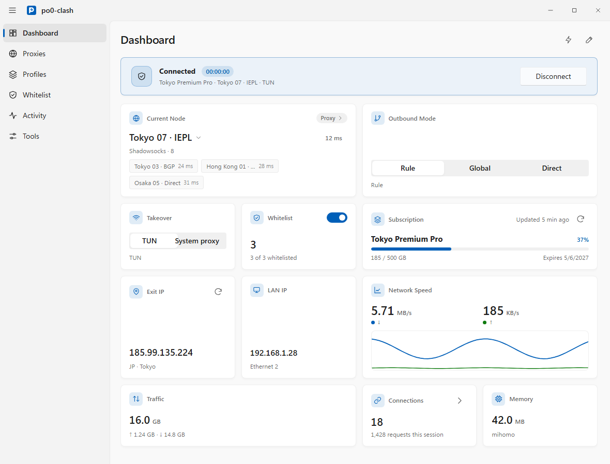
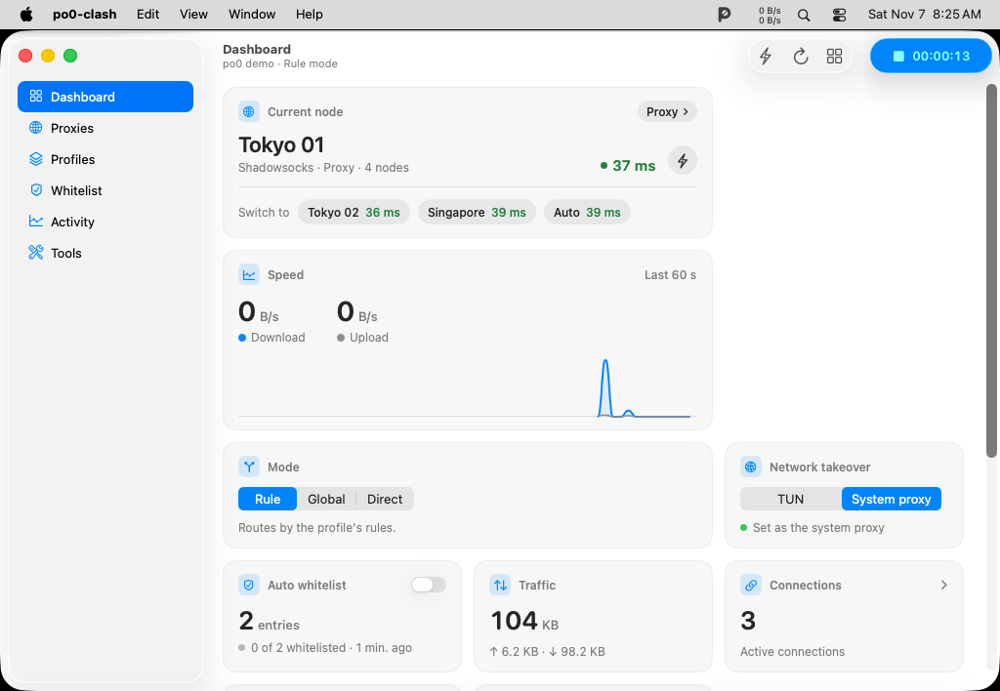
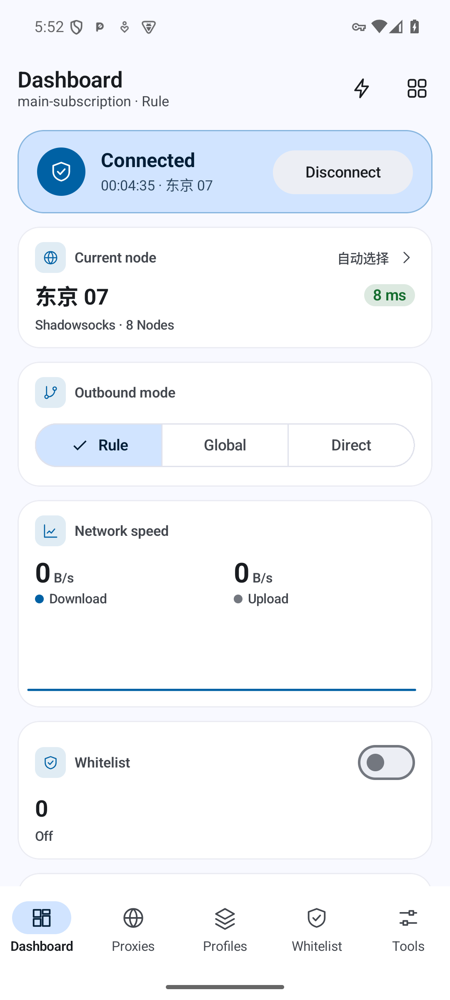
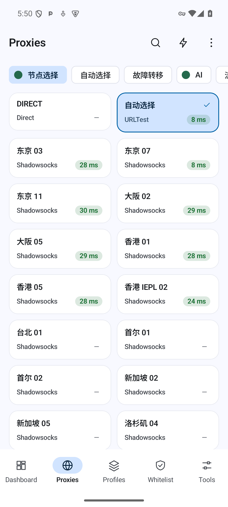
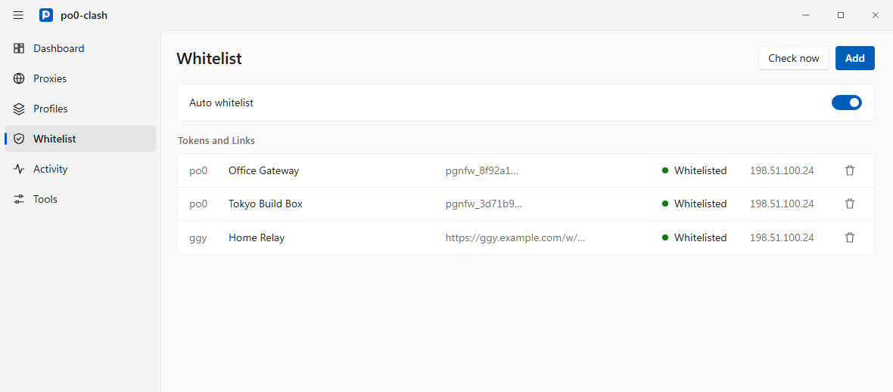

# po0-clash

[**简体中文**](README.md)

A native proxy client for macOS, Windows, and Android built on a shared Rust core (`crates/core`) and stock [`mihomo`](https://github.com/MetaCubeX/mihomo), with built-in `po0` and `ggy` firewall auto-whitelist ([`po0fw`](https://github.com/w0ven/po0fw)).

Each platform uses its own native UI toolkit instead of a cross-platform widget layer.

- **macOS (`apps/macos`)**: SwiftUI and AppKit with a macOS 26 Liquid Glass sidebar, unified toolbar, Bento dashboard grid, and menu bar panel.
- **Windows (`apps/windows`)**: Tauri 2 and Win32/DWM with a Windows 11 WinUI 3 (Fluent 2) 4-column Bento card grid, system tray, and global hotkeys.
- **Android (`apps/android`)**: Kotlin and Jetpack Compose with a Material 3 Expressive card grid, in-process `libmihomo`, Quick Settings tile, and Android TV Leanback entrance.

`po0-clash` is a standalone app (`io.github.yuuukicreation.po0clash`) with its own installer ID, process and service names, data directory, and `po0clash://` URL scheme. It installs and runs side by side with official [FlClash](https://github.com/chen08209/FlClash).

## Screenshots

### Windows 11 (WinUI 3 / Fluent 2)

<p align="center">
  <picture>
    <source media="(prefers-color-scheme: dark)" srcset="docs/features/images/windows_dashboard_dark_en.png">
    
  </picture>
</p>

### macOS 26 (SwiftUI Liquid Glass)

<p align="center">
  <picture>
    <source media="(prefers-color-scheme: dark)" srcset="docs/features/images/macos_dashboard_dark_en.png">
    
  </picture>
</p>

### Android (Jetpack Compose Material 3 Expressive)

<p align="center">
  
  &nbsp;&nbsp;
  
</p>

## Features

- **`po0` and `ggy` auto-whitelist**: Manage `po0` tokens (`pgnfw_`) and `ggy` links on one **Whitelist** page. While the app is open, `po0` entries perform a read-only check every 5 seconds and write only when your `/24` is missing, and `ggy` links refresh every 11 seconds. Whitelist requests bypass the proxy across all three layers (`po0-direct` listener, `DIRECT` rule + `route-exclude-address`, and Android VPN route split), so your physical exit IP is whitelisted whether or not the proxy is connected.
- **Profiles and overrides**: Import Clash subscriptions (with traffic and expiry tracking and scheduled auto-update), local YAML files, or share links (`ss://`, `vless://`, `vmess://`, `trojan://`, `hysteria2://`, and more, with per-node rename and delete). Inspect or edit raw configs, preview the merged config, and customize profiles through standard overrides, JavaScript scripts (`main(config)`), or custom proxy groups and rules YAML.
- **Dashboard, proxies, and live telemetry**: Rearrangeable Bento dashboard cards (traffic chart, live speed, outbound mode, network detection, memory, quick toggles, and subscription summary), tabbed or list proxy views with search, sorting, and concurrent delay testing, and a unified **Activity** view for recent requests, active connections, and filterable logs.
- **System integration and backup**: TUN and system proxy on desktop, `VpnService` with per-app access control and excluded-SSID auto-disconnect on Android, Geo database (`GeoIP.dat`, `GeoSite.dat`, `country.mmdb`, `ASN.mmdb`) and external provider management, WebDAV and local `.zip` backup and restore, crash-loop protection, and localization in Simplified Chinese, English, Japanese, and Russian.

## Install

Download the installer for your platform from [Releases](https://github.com/yuuuki-creation/po0-clash/releases), or run the one-line install script on Windows or macOS. Detailed instructions are in [docs/install.md](docs/install.md).

### Windows (Windows 10 / 11 x64)

Run this command in PowerShell to download the latest installer, verify its SHA-256 checksum, and install silently:

```powershell
irm https://github.com/yuuuki-creation/po0-clash/releases/latest/download/install-windows-native.ps1 | iex
```

Or download `po0-clash-<version>-windows-x64-setup.exe` from [Releases](https://github.com/yuuuki-creation/po0-clash/releases) and run it directly.

- The installer is not Authenticode-signed. If Windows SmartScreen appears, click **More info** and then **Run anyway**. If Windows 11 Smart App Control blocks the binary, turn off Smart App Control in **Windows Security** -> **App & browser control** -> **Smart App Control settings**.
- `po0-clash` runs as administrator on Windows so TUN can create its virtual network adapter.

### macOS (macOS 13+, Apple Silicon & Intel Universal)

Run this command in Terminal to download the latest release, verify its SHA-256 checksum, install `/Applications/po0-clash.app`, clear the quarantine attribute, and launch the app:

```bash
curl -fsSL https://github.com/yuuuki-creation/po0-clash/releases/latest/download/install-macos-native.sh | bash
```

Pass a version tag or a local `.zip` path after `bash -s --` to install a specific build:

```bash
curl -fsSL https://github.com/yuuuki-creation/po0-clash/releases/latest/download/install-macos-native.sh | bash -s -- 7.3.0
```

On first TUN activation, macOS prompts once for an administrator password to grant setuid-root permissions to the bundled `mihomo` binary.

### Android (Android 8.0+)

Download and install the APK matching your device ABI from [Releases](https://github.com/yuuuki-creation/po0-clash/releases):

| APK | Target devices |
|---|---|
| `po0-clash-<version>-android-arm64-v8a.apk` | Most modern Android phones, tablets, and TV boxes (recommended) |
| `po0-clash-<version>-android-armeabi-v7a.apk` | Older 32-bit ARM devices |
| `po0-clash-<version>-android-x86_64.apk` | 64-bit x86 emulators and devices |

Only enable system proxy or TUN/VPN in one proxy client at a time so two clients do not compete for routes.

### Upgrading from earlier builds

- **From `po0-clash` 5.x / 6.x (Flutter builds)**: Install 7.3+ directly over the existing app. On Windows, the NSIS installer removes the old Inno Setup installation first. On macOS, the install script replaces `/Applications/po0-clash.app`. On Android, the APK upgrades in place. On first launch, 7.3+ automatically imports your existing subscriptions and whitelist entries. WebDAV and local `.zip` backups exported from the Flutter app can also be restored in **Tools** -> **Backup**.
- **From legacy `v0.8.98-po0.N` builds**: Those builds used the upstream `FlClash` app ID, so `po0-clash` does not overwrite them. Export a backup or copy your tokens from the old app, import them into `po0-clash`, and uninstall the old build manually.

## Using the whitelist

<p align="center">
  <picture>
    <source media="(prefers-color-scheme: dark)" srcset="docs/features/images/whitelist_dark_en.png">
    
  </picture>
</p>

1. Open **Whitelist** in the navigation bar.
2. Paste a `po0` token (`pgnfw_...` or full URL) or a `ggy` link (`http(s)://...`), add an optional label, and click **Add**.
3. Keep the **Whitelist** master switch turned on. You can also click **Run now** on the page or in the system tray / menu bar to trigger an immediate check.

## Architecture and development

| Path | Description |
|---|---|
| [`crates/core`](crates/core) | Shared Rust core for profile management, config merge and overrides, `mihomo` supervision and REST/WS client, `po0`/`ggy` whitelist engine, and WebDAV/local backup |
| [`crates/ffi`](crates/ffi) | UniFFI bindings exposing `po0-core` to Swift (macOS) and Kotlin (Android) |
| [`apps/macos`](apps/macos) | Native macOS 13+ app (SwiftUI + AppKit) |
| [`apps/windows`](apps/windows) | Native Windows 10/11 app (Tauri 2 + Svelte 5 + Win32/DWM) |
| [`apps/android`](apps/android) | Native Android 8.0+ app (Kotlin + Jetpack Compose + JNI `libmihomo`) |

Design documents, architecture decision records, and build guides are in [`docs/`](docs/README.md). Repository conventions for contributors and coding agents are in [`AGENTS.md`](AGENTS.md).

## Credits and license

- [MetaCubeX/mihomo](https://github.com/MetaCubeX/mihomo) for the Clash Meta proxy core
- [chen08209/FlClash](https://github.com/chen08209/FlClash) for the original upstream client that inspired `po0-clash`
- [w0ven/po0fw](https://github.com/w0ven/po0fw) for the `po0` firewall whitelist protocol

Released under [GPL-3.0](LICENSE).
